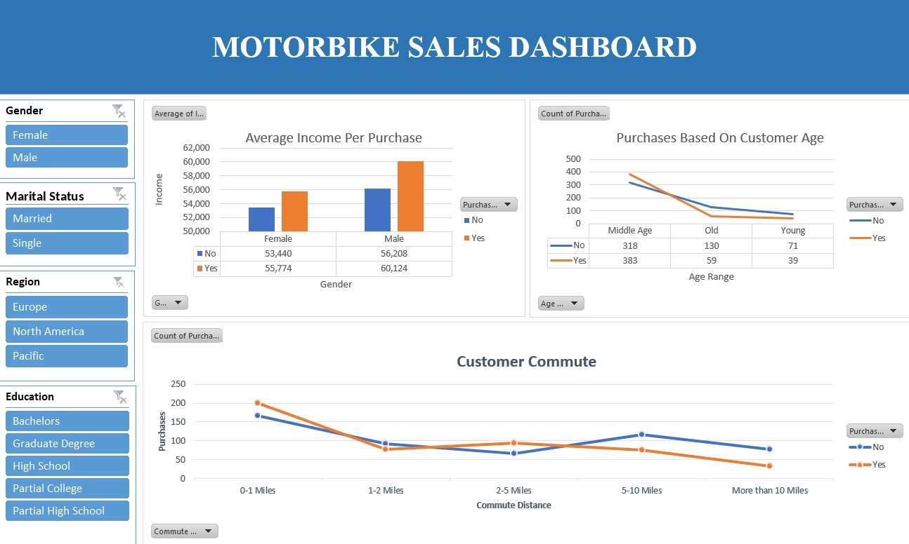

# Dashboard Guide

Workbook: [`excel/Motorbike_Sales_Project.xlsx`](../excel/Motorbike_Sales_Project.xlsx)

| Sheet | Contents |
|---|---|
| `bike_buyers (Raw Data)` | Original data, 1,026 rows |
| `Working Sheet (Cleaned)` | Cleaned data, 1,000 rows, with `Age Range` |
| `Pivot Table` | The three PivotTables behind the charts |
| `Dashboard` | Three charts and four slicers |

## PivotTables
| # | Values | Rows | Columns | Chart |
|---|---|---|---|---|
| 1 | Average of Income | Gender | Purchased Bike | Clustered column - *Average Income Per Purchase* |
| 2 | Count of Purchased Bike | Age Range | Purchased Bike | Line - *Purchases Based On Customer Age* |
| 3 | Count of Purchased Bike | Commute Distance | Purchased Bike | Line - *Customer Commute* |

All three PivotTables share one data source, so every slicer filters every chart.

## Slicers
Gender · Marital Status · Region · Education

## How to use
1. Open the workbook in desktop Excel and go to the **Dashboard** sheet.
2. Click a slicer button to filter (Ctrl+click for several); use the funnel icon to clear it.
3. If numbers look out of date, use **Data → Refresh All**.

